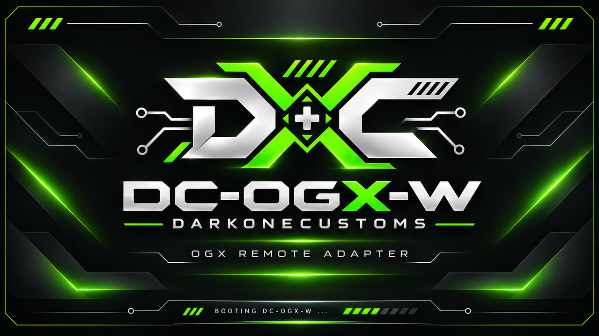

# DC-OGX-W

<div align="center">
  
</div>

**An RP2040-based controller adapter for the original Xbox and compatible USB output modes.** DC-OGX-W combines a self-hosted WebUI, Wi-Fi remote input, controller profiles, an optional 0.91-inch OLED, and an RGB status LED. The project builds on OGX-Mini and is maintained by **Darkone83 / Darkone Customs**.

**Firmware source version:** `0.2.4` in this repository snapshot. Check the board identity and firmware version of bundled images before flashing.

## Repository layout

| Path | Contents |
|---|---|
| [`src/`](src/) | **Firmware project root**: `CMakeLists.txt`, `CMakePresets.json`, `boards/`, `cmake/`, `src/` C++ source, embedded WebUI and runtime assets |
| [`firmware/`](firmware/) | Supplied `.uf2` and board-specific `.ogxw` files for both variants; verify versions before release |
| [`apps/Windows/bin/`](apps/Windows/bin/) | Supplied portable Windows companion executable |
| [`apps/Windows/src/`](apps/Windows/src/) | Tauri 2 / Rust Windows companion source and build configuration |
| [`apps/Python/`](apps/Python/) | Python remote and PySide6 GUI for Windows, Linux and macOS, with dependency bootstrap launchers |
| [`PCB/`](PCB/) | Board fabrication ZIP, schematic, BOM, pick-and-place and layout images |
| [`STL/`](STL/) | Two-piece printable enclosure (lid and base) |
| [`assets/branding/`](assets/branding/) | Logos, WebUI theme references, splash, display assets and product art |
| [`docs/`](docs/) | Build instructions, API reference, software architecture, OLED, USB-host bring-up and WebUI guides |

## Supported boards

| Board | CMake preset | Network hardware | Controller sources |
|---|---|---|---|
| Pico W-2023 clone | `pico-w-2023` | Onboard ESP8285, UART0 GP0/GP1, existing legacy AT firmware | Wi-Fi WebUI, desktop remote and PIO-USB host; no Bluetooth |
| Official Raspberry Pi Pico W | `pico-w` | CYW43439 Wi-Fi/Bluetooth | WebUI, desktop remote, supported Bluetooth controllers and PIO-USB host |
| Official Raspberry Pi Pico 2 W | `pico2-w` | CYW43439 Wi-Fi/Bluetooth | WebUI, desktop remote, supported Bluetooth controllers and PIO-USB host; additional console support planned |

Both use the RP2040's native USB connector for USB **device output**. Other accessory pins: **GP8** RGB LED, **GP14 SDA / GP15 SCL** I²C1 OLED, and **GP9 D+ / GP10 D−** for PIO-USB **host input**. Host input is translated controller data, not electrical USB passthrough.

## Build firmware

Install the Raspberry Pi Pico VS Code extension with **Pico SDK 2.3.0**, ARM toolchain, CMake, Ninja, Python 3 and Git. Open **`src/` as the firmware project** (or point the extension directly at its `CMakeLists.txt`). Normal compilation should work from VS Code's **Compile** action after a one-time environment configuration.

From a terminal in `src/`:

```powershell
cmake --preset pico-w-2023
cmake --build --preset pico-w-2023 --parallel
```

For the official Pico W use `pico-w` in both commands. The presets maintain separate build directories. Generated files should appear below `src/build/<preset>/` and include `dc-ogx-w.uf2` and `dc-ogx-w-<board>.ogxw` on successful packaging.

**Firmware packager path:** `src/tools/firmware/make_update.py` (path relative to the **repository**). The CMake post-build step references `tools/firmware/make_update.py` relative to the firmware project root.

First flash: put the RP2040 into **BOOTSEL** mode and copy the correct board's UF2 to the RP2040 mass-storage drive. Later firmware updates use the WebUI's `.ogxw` updater. That updater does **not** update the ESP8285's installed AT firmware. An interrupted final flash copy may require BOOTSEL recovery—there is no automatic A/B rollback. See [build and flashing](docs/BUILD_AND_FLASH.md).

## WebUI and connected input

Connect to the adapter's SoftAP, usually `dc-ogx-w-XXXX`, with password `ogxremote`, then visit `http://192.168.4.1/`. If the device is on your home network, use its LAN IP or try `http://dcogxw.local/` when mDNS is supported by your client. mDNS is advertised on station Wi-Fi, **not SoftAP**; use `192.168.4.1` for SoftAP. AP-to-station behavior and UDP discovery depend on the firmware and radio variant.

The embedded UI includes **Control, Profiles, Wi-Fi, LED and Device**, desktop sidebar/mobile drawer, eight appearance themes, remappable keyboard controls (including original Xbox White and Black), device profiles/calibration, OLED configuration, and firmware updating. The browser-based gamepad preview is a **local approximation**, not measured controller output. UI assets are embedded without a CDN. See [WebUI themes](docs/WEBUI_THEMES.md), [OLED UI](docs/OLED_UI.md), and [remote API](docs/remote-api.md).

## Desktop companions

**Windows:** run the supplied [`apps/Windows/bin/dc-ogx-w.exe`](apps/Windows/bin/dc-ogx-w.exe) or build the portable Tauri/Rust app from [`apps/Windows/src/`](apps/Windows/src/). It uses the adapter's HTTP/WebSocket control APIs, supports keyboard/XInput input, controller White/Black buttons, settings, profiles and discovery when supported by firmware. Full advanced profile editing and firmware upload remain in the device WebUI. The binary in this archive has **not** been independently verified against the latest source patch.

**Linux/macOS (also Windows):** use [`apps/Python/start-remote.sh`](apps/Python/start-remote.sh), `start-remote.command` on macOS or `start-remote.cmd` on Windows. The Python launcher creates a private `.venv-ogx` and installs missing `aiohttp`, PySide6 and pygame packages at first launch (internet required). See [companion apps](docs/COMPANION_APPS.md).

## Hardware and release status

The 0.91-inch SSD1306 display is **128×32**, connected over I²C1. The WebUI supports contrast, idle dim/off, inversion, rotation and startup fade; brightness and animated presentation have been iterated on physical hardware. The two-part enclosure has **STL files** for FDM printing; allow for connector/module variants and perform a physical fit check.

## Project information

- [Contribution guidelines](CONTRIBUTING.md) · [Security](SECURITY.md) · [Credits and third-party notices](CREDITS.md) · [License](LICENSE)
- [Software architecture](docs/SW_FRAMEWORK.md) · [USB host](docs/USB_HOST.md) · [API](docs/remote-api.md)

**Attribution:** Darkone83 / Darkone Customs; derived from [MegaCadeDev/OGX-Mini-2026](https://github.com/MegaCadeDev/OGX-Mini-2026) and [wiredopposite/OGX-Mini](https://github.com/wiredopposite/OGX-Mini). Preserve all applicable upstream licenses and notices.
