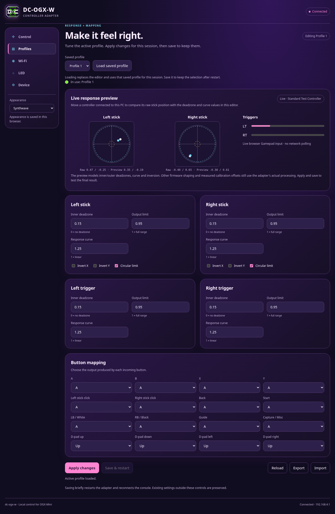

# DC-OGX-W

<div align="center">
  
</div>

**A wireless, RP2040-based controller adapter with an on-device WebUI, configurable profiles, Wi-Fi input, and optional OLED status display.** Built under **DarkoneCustoms / Darkone83**, on the OGX-Mini controller foundation.

**Source version:** 0.2.4 · **Project stage:** development and hardware validation · **Target:** original Xbox and other supported USB device output modes. This repository is source-first; do not assume a prebuilt UF2 is included.

## What it does

- **Play through the adapter:** Use a browser, **reassignable keyboard controls**, on-screen gamepad, or PC gamepad to send controller input over Wi-Fi to the RP2040's built-in USB output.
- **Profiles and calibration:** Configure button mapping, analog axes, dead zones, and saved profiles in the WebUI. Bluetooth-capable boards also expose physical controller configuration.
- **Self-hosted WebUI:** A responsive desktop sidebar and mobile menu; eight browser-local themes; the Profiles editor includes a live stick/trigger response preview when a gamepad is connected to the computer running the WebUI. No cloud service or external assets.
- **OLED status display:** Optional 0.91-inch 128×32 SSD1306 on I²C1 shows the DXC splash, IP/profile/network state, reusable icons, operation animations and update progress. **Device → OLED display** now supports live brightness, dim/off timeouts, idle brightness, inversion, flip, startup fade, and persistent preferences.
- **Status LED:** Optional WS2812 on GP8 for profile and diagnostic indications.
- **Firmware updating:** Upload a board-specific `.ogxw` image through the WebUI after the first UF2 installation; the updater validates before installation.
- **Home network joining:** Configure 2.4 GHz station credentials. SoftAP is used for first-time setup and while joining, then automatically switches off once home Wi-Fi has a confirmed IP. It returns as a recovery network after a sustained home-network loss; active users must access the WebUI using the home-network IP or `.local` name. Wi-Fi behavior depends on the radio/firmware installed in your board.

## Hardware

| Board | Firmware preset | Wireless input | USB output |
|---|---|---|---|
| RP2040 Pico W-2023 clone **with ESP8285** | `pico-w-2023` | Wi-Fi through ESP8285 AT firmware; **no Bluetooth** | Board's built-in USB connector |
| Official Raspberry Pi Pico W (CYW43439) | `pico-w` | Native Wi-Fi and supported Bluetooth controllers | Board's built-in USB connector |

Both boards retain the same RP2040-facing accessory pins:

| Accessory | Pins | Notes |
|---|---|---|
| ESP8285 AT modem (clone only) | **GP0 TX / GP1 RX** | UART0 at base 115200 baud; firmware negotiates faster volatile rates when supported |
| WS2812 status LED | **GP8** | One external LED, configurable and optional |
| SSD1306 OLED | **GP14 SDA / GP15 SCL** | I²C1, **128×32**, address 0x3C; 3.3 V module |
| Proposed USB controller input (future hardware) | **GP9 D+ / GP10 D−** | PIO-USB host candidate; **not enabled in this firmware** |

The OLED is optional. Without a connected panel, device operation continues; display probing is bounded. GP14/GP15 must remain free for I²C. The current hardware build is **not** an Xbox-side HDMI, Ethernet, or USB-host interface. A future USB-A host input on GP9/GP10 is planned for the candybar PCB; USB output remains on the RP2040 native USB connector. Host input is a translated controller source, **not** electrical USB passthrough.

## Getting started

1. Install the **Raspberry Pi Pico** VS Code extension, Pico SDK **2.3.0**, Arm toolchain, CMake, Ninja, Python, and Git. Open this repository folder in VS Code.
2. Choose your actual hardware preset. Do **not** switch the hardware in an already-configured build directory.
3. Configure and compile in a Pico SDK terminal:

   **Pico W-2023 / ESP8285:**

   ```cmd
   cmake --preset pico-w-2023 && cmake --build --preset pico-w-2023 --parallel
   ```

   **Official Pico W:**

   ```cmd
   cmake --preset pico-w && cmake --build --preset pico-w --parallel
   ```

4. With the RP2040 in **BOOTSEL**, copy the appropriate `build/<preset>/dc-ogx-w.uf2` to the RP2040 boot drive. The clone's separate ESP boot/DOOT button is **not** used for RP2040 UF2 installation.
5. Join the adapter's SoftAP **`dc-ogx-w-XXXX`** with the default password **`ogxremote`**, then open **http://192.168.4.1/**.
6. In the WebUI, choose an input source, connect, adjust profiles, and optionally join your home 2.4 GHz Wi-Fi network.

**Note for ESP8285 clones:** The RP2040 build does **not** update ESP8285 AT firmware. The legacy AT 1.6.x firmware may not provide reliable `.local` mDNS resolution. Use the IP displayed on the OLED or WebUI. The adapter still works without hostname resolution.

## WebUI and themes

The embedded WebUI retains the existing **Control**, **Profiles**, **Wi-Fi**, **LED**, and **Device** functions. Desktop now uses persistent left navigation; a compact menu drawer handles narrow mobile viewports without hiding essential controls. The old redundant "Controller Workbench" heading is gone.

**Eight selectable themes** are available: Darkone Green, Theia-inspired Dark, Midnight Blue, Synthwave, Ember, Retro Terminal, Theia-inspired Light, and Arctic Light. Their differences include typography, density, corners and surfaces as well as colors. Theme choice is stored in this **browser's** local storage: changing browsers/devices does not synchronize the preference to adapter flash.

**Profile deadzone/curve preview:** The Profiles tab now includes two live stick plots and trigger bars beside the tuning workflow. When a USB/Bluetooth gamepad is connected to the computer or phone *running the browser* and the browser Gamepad API exposes it, raw input is visualized alongside the **approximate** output from the editable deadzone, curve, and inversion values. This is a **local preview**, not the device's measured output and not an exact emulation of every hardware profile-shaping behavior. It adds no ESP8285 traffic. Actual adapter-side USB/BT input telemetry remains future work.

<div align="center">
  
</div>

**Keyboard mapping:** Under **Control → Keyboard mapping**, click any button or direction assignment, then press the new key. All face/menu/shoulder/trigger/D-pad controls, both stick direction sets, and Guide are reassignable. If a key is already assigned, the two actions swap keys rather than creating duplicates. Use **Reset keys** to restore defaults. **F8** takes/releases control; **Esc** cancels a pending assignment or releases control. Held inputs are cleared when changing bindings or losing browser focus. Keyboard assignments use browser `localStorage` and are **not** console profile mappings; they do not move between browsers. Browser/system shortcut chords and F8/Esc are reserved.

All page assets remain embedded and offline-capable. For detailed palettes and design notes, see [WebUI themes](docs/WEBUI_THEMES.md) and [shared software framework](docs/SW_FRAMEWORK.md).

## 0.91-inch OLED

The SSD1306 displays the **DXC monochrome splash** briefly after startup, then rotates through IP, profile and network pages. It now uses reusable 16×16 operation glyphs and gently animated status dots. An accepted profile or settings operation temporarily replaces the normal view with a load/apply/save notice. Firmware receiving, install, ready and error take priority, with upload progress rounded to reduce I²C traffic. Details: [OLED interface](docs/OLED_UI.md).

The panel size for both presets is **128×32**. **Device → OLED display** provides brightness/contrast (0–255), idle brightness, selectable dim and display-off timeouts (Never, 30 s to 1 hour), enable, invert, 180° flip and startup fade. **Apply now** changes the running display without writing flash; **Save and restart** persists the current form values in the adapter's independent `oled-v1` NVS record. **Defaults** selects the firmware's compiled defaults, then still requires Apply or Save. On first boot without saved settings, CMake `DC_OGX_OLED_CONTRAST`, `DC_OGX_OLED_FADE_ENABLED`, `DC_OGX_OLED_IDLE_DIM_MS` and `DC_OGX_OLED_IDLE_CONTRAST` determine initial values. Screen-off issues the SSD1306 `0xAE` command, not a physical module power cut; meaningful activity wakes it. Missing OLED hardware does not prevent device boot. Its physical viewable area is small, so screens avoid dense text. **OLED screens and brightness behavior require physical panel validation.**

## Firmware updates and recovery

The first firmware installation uses **BOOTSEL + UF2**. Later updates use the **Device → Firmware update** flow and the appropriate checked `.ogxw` file generated with the build. Keep power connected for final installation. **There is no automatic A/B rollback** if power is interrupted during the final flash copy; recovery may require BOOTSEL.

The WebUI updater only changes RP2040 firmware, not ESP8285 AT firmware. Consult [updater documentation](tools/firmware/README.md) before flashing. The ESP diagnostics application under `tools/esp8285` is a separate maintenance utility, not the adapter firmware.

## Project layout

| Path | Content |
|---|---|
| `src/` | Board drivers, networking, controller services, OLED, firmware updater, embedded WebUI |
| `boards/`, `cmake/`, `CMakePresets.json` | RP2040 board targets and build configuration |
| `assets/branding/` | Individually split logo assets, monochrome OLED mark, splash image and theme previews |
| `tests/` | Native transport, HTTP, LED, OLED, updater and protocol tests |
| `tools/pc/` | Browser/Python bridge tools for development and PC input |
| `tools/firmware/` | Update package format and packager |
| `docs/` | Technical detail, branding guidance, display/UI notes, future controller protocol |
| `.github/` | Issue templates, pull request template, host-test CI |

## Current limitations and planned work

- The **ESP8285** Wi-Fi implementation shares an AT UART command engine with HTTP/control traffic. Reconnection and timeouts have been improved, but uninterrupted Wi-Fi cannot be guaranteed by software alone. The ESP8285 clone does not currently enable UDP discovery.
- Native UDP discovery exists for the **official Pico W**. The separate Windows companion app, exclusive low-latency UDP input session, Bluetooth handoff and feedback transport remain **future work**, not currently supported controls.
- Optional PIO-USB **host input on GP9/GP10 is planned, not implemented**. The CMake flag `DC_OGX_USB_HOST_ENABLED` intentionally fails if enabled; only the pin mapping is staged. Hardware design/verification is separate.
- Performance figures and radio compatibility must be validated on real hardware and host consoles. The repo includes native host tests; it is not a substitute for hardware QA.

See [roadmap and protocol notes](docs/oled-udp-foundation.md), [planned USB host integration](docs/USB_HOST_SOFTWARE_PLAN.md), and [development notes](docs/DEVELOPMENT_NOTES.md).

## Contributing and reporting issues

Read [CONTRIBUTING.md](CONTRIBUTING.md) for development guidelines, test commands, and pull-request expectations. Use a GitHub issue to report a reproducible problem; include which board and firmware were tested. For security-sensitive reports, read [SECURITY.md](SECURITY.md).

## Credits and licenses

DC-OGX-W development, product design, WebUI and branding: **Darkone83 / DarkoneCustoms**.

The controller implementation derives from [MegaCadeDev/OGX-Mini-2026](https://github.com/MegaCadeDev/OGX-Mini-2026), which builds on [wiredopposite/OGX-Mini](https://github.com/wiredopposite/OGX-Mini). This source package retains upstream copyright and license notices. Additional acknowledgments, individual dependencies and license considerations (including Bluepad32, BTstack, TinyUSB, libxsm3 and its ExCrypt component) are documented in [CREDITS.md](CREDITS.md) and [LICENSE](LICENSE).

*Unofficial original Xbox community project; not affiliated with or endorsed by Microsoft.*
